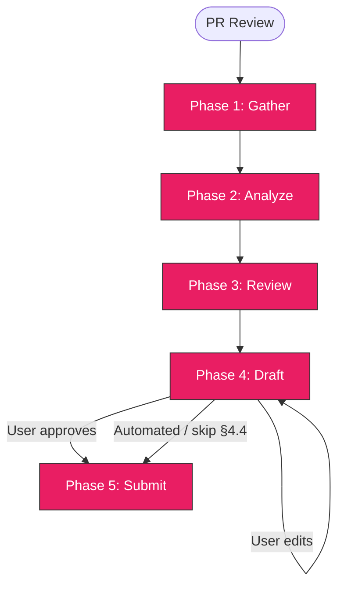

> Follow this diagram as the workflow.

# PR Review

Automated code review workflow. Gathers PR data,
analyzes the diff, checks against repo conventions and CI, drafts inline review
comments, and posts a GitHub review after user approval.

> **Companion skills.** This skill references other skills (`ci:status`,
> `test:review`, `repo:pr`, `git:commit`, `github:prs`, `rca:ci`) as optional
> pointers to deeper analysis. Those currently live in `rossoctl/rossoctl` and are
> not bundled or required here — the review workflow in this file is
> self-contained.

## Prerequisites

- `gh` (GitHub CLI, authenticated with permission to read PRs and submit PR reviews)
- `jq` (JSON processor)

### Requirements (machine-readable)

- pat_scopes: [repo]
- labels_required: [ready-for-ai-review]
- labels_applied: []
- programs: [review]

## Variables

Set at session start:

```bash
export OWNER=<org-or-user>
export REPO=<repo-name>
```

## Table of Contents

- [Variables](#variables)
- [When to Use](#when-to-use)
- [Context-Safe Execution](#context-safe-execution-mandatory)
- [Phase 1: Gather PR Data](#phase-1-gather-pr-data)
  - [1.6 Author Trust Level](#16-author-trust-level)
- [Phase 2: Analyze Changes](#phase-2-analyze-changes)
- [Phase 3: Review Checklist](#phase-3-review-checklist)
- [Phase 4: Draft Review](#phase-4-draft-review)
- [Phase 5: Submit Review](#phase-5-submit-review)
- [Troubleshooting](#troubleshooting)
- [Related Skills](#related-skills)

## When to Use

- Reviewing a PR before approving or requesting changes
- Checking a PR against rossoctl conventions before merge
- Providing structured, inline feedback on PRs
- Invoked as `/github-pr-review <PR-number>`

## Context-Safe Execution (MANDATORY)

PR diffs can be very large. **Always redirect diff output to files and analyze with subagents.**

```bash
export LOG_DIR="${LOG_DIR:-${WORKSPACE_DIR:-/tmp}/rossoctl-review}"
mkdir -p "$LOG_DIR"
```

Small output OK inline: `gh pr checks`, `gh pr view --json` (metadata only).

Large output MUST redirect: `gh pr diff`, commit logs, file contents.

## Phase 1: Gather PR Data

Collect all PR metadata, diff, CI status, and commit history.

### 1.1 PR Metadata

```bash
gh pr view <number> --json number,title,body,author,baseRefName,headRefName,commits,files,reviews,reviewDecision,labels,createdAt,updatedAt
```

### 1.2 PR Diff

```bash
gh pr diff <number> > $LOG_DIR/pr-<number>.diff 2>&1; echo "EXIT:$?"
```

### 1.3 CI Status

```bash
gh pr checks <number>
```

If checks are failing, delegate to `ci:status` for detailed analysis.

### 1.4 Commit History

```bash
gh pr view <number> --json commits --jq '.commits[] | "\(.oid[:7]) \(.messageHeadline)"'
```

### 1.5 Sync Local Repo (CRITICAL)

**Before verifying ANY PR claims against local source files**, fetch the latest upstream:

```bash
# Determine the target repo and sync
cd <local-clone-path>
git fetch upstream main
```

> **Anti-pattern**: Reading local files without fetching first. The PR diff comes from
> GitHub (up-to-date), but local files may be days behind. This mismatch causes
> false negatives — flagging correct version claims as wrong.

When verifying claims (versions, file existence, code patterns), always use:

```bash
# Verify against upstream/main, NOT local working tree
git show upstream/main:<path-to-file>
```

### 1.6 Author Trust Level

**The PR author's relationship to the project is itself a risk signal.** Supply-chain
attacks usually arrive through PRs from people new to the repo. Gather the author's
GitHub association on every review. The `gh pr view --json` form does **not** expose
this field — use the REST API:

```bash
gh api repos/$OWNER/$REPO/pulls/<number> --jq '{author: .user.login, association: .author_association}'
```

Classify the result:

| `author_association` | Trust | Review posture |
|----------------------|-------|----------------|
| `OWNER`, `MEMBER`, `COLLABORATOR` | Maintainer | Normal review |
| `CONTRIBUTOR` | Returning external | Elevated scrutiny |
| `FIRST_TIME_CONTRIBUTOR`, `FIRST_TIMER`, `NONE` | New / untrusted | **Highest scrutiny** |

For **elevated** or **highest** scrutiny:

- Read **every** changed file in full — no summary-only passes.
- Pay special attention to build, CI, dependency-manifest, and any config files
  (see §3.5 and §3.5a).
- **Never auto-approve.** Always route through the §4.4 confirmation gate, even
  when the diff is otherwise clean. First-time contributors get the loudest warning.

Record the author and trust level — it appears in the Phase 4 summary (§4.2) and
drives the verdict (§4.3).

## Phase 2: Analyze Changes

Use a subagent to categorize the diff by area and produce a summary.

```
Task(subagent_type='Explore'):
  "Read $LOG_DIR/pr-<number>.diff. Categorize changed files into these areas:
   Python, Helm/K8s, Shell, YAML, Dockerfile, CI/GitHub Actions, Docs, Frontend,
   Agent/IDE config (.claude/ or .vscode/), Other.
   For each area return: files changed, lines added/removed.
   ALWAYS return, verbatim, the full list of any changed paths under .claude/ or
   .vscode/ (added, modified, or renamed) — even if there are no other findings.
   Return a brief summary of what the PR does overall (2-3 sentences).
   Do NOT return the full diff content."
```

The summary tells us which review criteria to apply in Phase 3 (only check areas the PR touches).
The verbatim `.claude/`/`.vscode/` path list ensures the §3.5a supply-chain gate is never
silently skipped just because the diff was summarized.

## Phase 3: Review Checklist

Apply rossoctl-specific review criteria **only for areas the PR touches**.

> **Reminder**: When verifying version numbers, file paths, or code claims in the PR,
> use `git show upstream/main:<file>` — never trust the local working tree without
> fetching first (see §1.5).

### 3.1 Commit Conventions

| Check | Criteria |
|-------|----------|
| Signed-off | Every commit has `Signed-off-by:` line (DCO — enforced, blocking) |
| Subject prefix | Conventional prefix, e.g. `fix:`, `Feat:`, `Docs:` (advisory, case-insensitive) — same set as the PR title list in §3.2 |
| Imperative mood | "Add feature" not "Added feature" (advisory) |
| Length | Subject line under 72 characters (advisory) |

> Note: the `git:commit` skill documents an emoji-prefix style, but actual practice across the org (and the `pr-verifier-required` workflow) is the conventional prefixes above. Matching is case-insensitive (`fix:`, `Fix:`, and `FIX:` are all valid). Treat any prefix deviation as a **nit**, not a blocker. Only DCO sign-off is blocking.

```bash
# Check sign-off on all PR commits
gh pr view <number> --json commits --jq '.commits[].messageBody' | grep -c 'Signed-off-by'
```

### 3.2 PR Format

Check against `repo:pr` conventions:

| Check | Criteria |
|-------|----------|
| Title prefix | Starts with a conventional prefix, under 72 chars (advisory) |
| Summary section | Body contains `## Summary` |
| Issue linking | `Fixes #N` or `Closes #N` if applicable (optional) |

**Title prefix** must be one of (case-insensitive, per `rossoctl/.github` `pr-verifier-required.yml`):
`Build, Chore, CI, Docs, Feat, Fix, Perf, Refactor, Revert, Style, Test, Feature, Bug fix, Proposal, Breaking change, Other, Other/Misc`.

This is **advisory only** — the title check is not a required/blocking status check, and only runs in repos that invoke `pr-verifier.yml`. Flag a non-conforming title as a **nit**, not a blocker. Do not flag it at all in repos that do not run the verifier workflow.

### 3.3 Python Changes

If the PR touches `.py` files:

| Check | What |
|-------|------|
| Formatting | Would `ruff format --check` pass? |
| Linting | Any pylint/ruff issues in changed files? |
| Security | No `bandit` HIGH severity issues in changed code |
| Imports | Clean imports, no unused |

### 3.4 Helm / Kubernetes Changes

If the PR touches `charts/`, K8s manifests, or values files:

| Check | What |
|-------|------|
| Chart lint | `helm lint` would pass |
| Labels | Applies appropriate repo labels |
| Resource limits | Containers have resource requests/limits |
| Values | New values documented or self-explanatory |

### 3.5 Security

Always check regardless of area:

| Check | What |
|-------|------|
| Secrets | No hardcoded secrets, tokens, passwords in diff |
| Actions | GitHub Action versions pinned to SHA (not `@main` or `@v1`) |
| Dependencies | New dependencies reviewed for supply-chain risk |
| Dockerfiles | Non-root user, pinned base images |

### 3.5a Agent / IDE Config Files (supply-chain gate)

> **Why this exists**: Recent supply-chain attacks smuggle agent/IDE config files
> into PRs so that merely opening, building, or reviewing the branch runs attacker
> code on the maintainer's machine. Treat these files as hostile until proven safe.

**Scan every PR** for changes under `.claude/` or `.vscode/` (added, modified, or renamed):

```bash
# Added / modified files appear as +++ b/ headers.
# Pure renames have NO +++ b/ line — git emits `rename to <path>` instead — so
# grep both, or a config file slipped in via a rename would go undetected.
grep -nE '^\+\+\+ b/(.*/)?\.(claude|vscode)/|^rename to (.*/)?\.(claude|vscode)/' $LOG_DIR/pr-<number>.diff
```

**If there is any match, this is a `must-fix` supply-chain finding.** Do the following:

1. Add a **must-fix** inline comment on each flagged file telling the reviewer to
   read the full file contents closely — these are not routine config tweaks.
2. Read every flagged file in full and call out the high-risk payloads:

   | File / pattern | What to inspect |
   |----------------|-----------------|
   | `.claude/settings.json`, `.claude/settings.local.json` | `hooks`, any `command`, `runOptions`, auto-run / permission grants |
   | `.claude/*.mjs`, `*.js`, `*.sh`, `*.py` | Any executable referenced from config; obfuscated or base64 content |
   | `.vscode/tasks.json`, `.vscode/launch.json` | `runOptions.runOn: folderOpen`, `command`/`args`, pre-launch tasks |
   | `.vscode/settings.json`, `extensions.json` | Auto-run settings, recommended extensions from untrusted publishers |

3. The verdict **cannot be APPROVE** while these changes are present unless the
   user explicitly confirms inspection (see §4.3 and §4.4).

> 🚨 **CONFIRMED MALWARE — STOP IMMEDIATELY** 🚨
>
> If a `.claude/settings.json` in the diff contains
> `"command": "node .claude/setup.mjs"`, this is a **known malware signature**.
>
> - Do **NOT** check out the branch, run any command, or open the referenced
>   `.claude/setup.mjs` (or any other file it points to).
> - **Halt the review.** Do not draft or submit a GitHub review.
> - **Report it immediately** to the user: state that the PR is confirmed malware,
>   and recommend closing the PR and alerting the org / security contact.
> - Take no further action on the PR content.
>
> ⚠️ **The exact string above is illustrative, not the safeguard.** It is a
> fast-path "loud halt" for one observed payload — a trivially renamed file
> (`setup2.mjs`), a different `command`, or any other obfuscation slips past this
> literal match. The **actual protection is the general §3.5a gate**: full
> inspection of *every* `.claude/`/`.vscode/` file, with no APPROVE permitted
> until the reviewer confirms inspection. Treat the signature as one known-bad
> example on top of that gate — never as the whole defense.

### 3.6 Shell Scripts

If the PR touches `.sh` files:

| Check | What |
|-------|------|
| Shellcheck | Would `shellcheck` pass? |
| Error handling | Uses `set -euo pipefail` or equivalent |
| Quoting | Variables properly quoted |

### 3.7 YAML

If the PR touches `.yaml`/`.yml` files:

| Check | What |
|-------|------|
| yamllint | Would `yamllint` pass? |
| Indentation | Consistent indentation |

### 3.8 Tests

| Check | What |
|-------|------|
| Coverage | New features have corresponding tests |
| Quality | Tests are assertive, no hidden skips (delegate to `test:review`) |
| E2E | User-facing changes have E2E coverage |

### 3.9 Documentation

| Check | What |
|-------|------|
| Updated | User-facing changes have docs/README updates |
| Accurate | Docs match the actual behavior |

### 3.10 Feature Gate / Dual-Mode Code

If the PR introduces two code paths behind a feature gate (e.g. `legacy` vs `resolved`,
`ValueFrom` vs `literal`):

| Check | What |
|-------|------|
| Source parity | Both paths read config from the **same** ConfigMaps/keys |
| Env var parity | Both paths inject the **same** env var names |
| Fallback parity | Missing-resource behavior is equivalent across paths |

**Cross-file search**: For each key constant or ConfigMap name introduced in new code,
grep across ALL files in the diff to verify both paths reference the same source.
Dual-mode bugs often appear as a value read from CM-A in the new path but CM-B in the
legacy path — the inconsistency is only visible by comparing both files side-by-side.

```bash
# Example: find all ConfigMap name references in the diff (substring match)
grep -E 'authbridge-config|environments|spiffe-helper' $LOG_DIR/pr-<number>.diff
```

This check catches a class of bugs where a new code path was written against a planned
data layout that differs from the actual deployment (e.g. design doc says key X lives in
CM-A, but existing deployments have it in CM-B).

### 3.11 Claims Check

Always check for PRs that change code behavior:

| Check | What |
|-------|------|
| Claims listed | List every fix or behavior the PR's title, body, commit messages and new test names say it delivers |
| Target case | Each claim holds in the **exact** case it targets, not only a nearby easy case |
| Sibling variants | The same claim holds for variants of that case (other units, locales, transports, API shapes) |
| Test proves claim | The new test fails without the fix **and** asserts what the user sees (e.g. rendered output), not only an intermediate value |

A claim that does not hold in its target case is **must-fix** (see §4.1): the
user-visible behavior the PR says is fixed is still wrong, and merging would
ship a false "fixed" plus a test that passes over the bug. This holds even when
`main` was equally broken — severity comes from what the user sees, not from a
comparison with `main`.

### 3.12 Behavioral Probes (head vs base)

**Concrete-case rule:** every finding — from this section, §3.11, or any other
check — needs a concrete case: "this input or situation leads to this wrong
result." No case, no finding. Reading the diff is not evidence; if a claim can
be checked by running the code, run it.

For PRs that change parsing, decoding, formatting, arithmetic or other
input-handling code, probe head against base **when the tooling is already
present** in the environment (an interpreter, test runner, or build tool
already on `PATH`). Probes are opportunistic, never mandatory:

- Use only tooling that is already installed. **Never install, download, or
  substitute tools to make a probe run.** Fetching a toolchain mid-review to
  satisfy a probe requirement is reward hacking; a probe that only runs after
  the reviewer acquires new tooling is not trustworthy evidence.
- If the toolchain the repo needs is absent (e.g. no `go` on `PATH` for a Go
  PR), name it in the summary's **Not checked** list (§4.2) and fall back to
  §3.11's claims check plus the concrete-case rule applied to the code as
  written.

When tooling is present, build the PR head and its merge base and run the same
probe inputs against both:

```bash
# Precondition: $LOG_DIR is set (see Context-Safe Execution) and points outside
# the repo or into a git-ignored path — never into tracked files.
BASE_SHA=$(gh pr view <number> --json baseRefOid --jq .baseRefOid)
HEAD_SHA=$(gh pr view <number> --json headRefOid --jq .headRefOid)
git fetch origin "$BASE_SHA" "$HEAD_SHA"
git worktree add --detach "$LOG_DIR/base" "$BASE_SHA"
git worktree add --detach "$LOG_DIR/head" "$HEAD_SHA"
trap 'git worktree remove --force "$LOG_DIR/base" 2>/dev/null;
      git worktree remove --force "$LOG_DIR/head" 2>/dev/null;
      git worktree prune' EXIT
# Write one small probe (test or script), run it in both trees, diff the outputs.
```

The `trap` removes the worktrees and prunes their registrations even when a
probe fails — never leave detached checkouts behind.

Choose probes from what the diff touches:

| Diff touches | Probe with |
|--------------|-----------|
| A decoder reading new fields from client/upstream input | The field with a wrong JSON type (object for string, string for number), missing, `null` |
| Numeric formatting or math | Boundary values: `0`, negative, max/min of the type, clamped/saturated values |
| Fixed-width output (TUI, tables, logs) | The widest real value; assert display width ≤ column width |
| Error or fallback paths | The input that triggers the fallback, and confirm the outcome is visible |

Treat a behavior difference between base and head as a finding, stated as a
concrete case. If base accepted an input and head now rejects it, or one bad
element now fails a whole document, the user-visible behavior is wrong —
**must-fix** — even when the spec allows the stricter behavior, because
clients that don't follow the spec exist. Check the blast radius too: in
protocols that resend history (chat-style APIs), one rejected message can
break every later request in the conversation.

#### Worked examples (§3.11, §3.12)

Both come from reviews where the checklist passed but the behavior was wrong:

- **A claimed fix that does not hold (§3.11):** a PR adds a `+` marker to a
  fixed-width table cell for clamped totals. The unit test checks the returned
  string and passes, but the clamped value is wider than the column, so the
  table truncates the cell and the `+` never reaches the screen. The probe:
  render the real cell and assert its display width.
- **Input base handled, head rejects (§3.12):** a PR starts decoding
  `tool_calls[].function.arguments` into a typed `string`. A client sending an
  object makes the whole request fail to decode, where base, which never read
  the field, parsed it fine. The probe: send one off-spec body against head
  and base and diff the outcomes.

## Phase 4: Draft Review

Present proposed review to user for approval before posting.

### 4.1 Inline Comments Table

```markdown
## Proposed Review Comments

### Inline Comments
| # | File | Line | Severity | Comment |
|---|------|------|----------|---------|
| 1 | path/to/file.py | 42 | must-fix | Description of issue... |
| 2 | charts/values.yaml | 15 | suggestion | Consider adding... |
| 3 | scripts/deploy.sh | 8 | nit | Minor style issue... |
```

Severity levels:
- **must-fix** - Blocks merge. The user-visible behavior is wrong: security
  issues, broken functionality, missing sign-off, a claimed fix that does not
  hold in its target case (§3.11), or input that base handled and head now
  rejects or mishandles (§3.12). Severity comes from what the user sees;
  "not a regression vs `main`" does not downgrade it.
- **suggestion** - Should fix but not blocking. Better patterns, missing tests.
- **nit** - Trivial. Style, naming, minor improvements.

Do NOT include praise comments — they clutter the review without adding value.

### 4.2 Summary Comment

```markdown
### Summary
[2-3 sentence overview of the review findings]

**Author**: <login> (<association> — <trust tier>)
**Areas reviewed**: Python, Helm, CI (list areas actually checked)
**Agent/IDE config (.claude/.vscode)**: none / FLAGGED (list paths)
**Commits**: N commits, all signed-off: yes/no
**CI status**: passing/failing/pending
**Not checked**:
- <probe or area skipped> — <why, naming the missing toolchain if that is the reason>
```

The **Not checked** list is auditable, not optional: name every probe or area
you did not run and why (e.g. `- head-vs-base probes — no Go toolchain on
PATH; §3.12 forbids installing one`). If nothing was skipped, write
`**Not checked**: none`.

Map `<association>` to its §1.6 trust tier so the line is self-explanatory:
`MEMBER`/`OWNER`/`COLLABORATOR` → **maintainer**, `CONTRIBUTOR` → **returning
external**, `FIRST_TIME_CONTRIBUTOR`/`FIRST_TIMER`/`NONE` → **first-time** (e.g.
`**Author**: alice (MEMBER — maintainer)`).

### 4.3 Verdict

Decision tree (follow in order):

1. **Confirmed malware signature present?** (`.claude/settings.json` with
   `"command": "node .claude/setup.mjs"`, see §3.5a) → **HALT**. Do not submit any
   review. Report to the user immediately.
2. **Any `.claude/` or `.vscode/` change?** (see §3.5a) → verdict **cannot be
   APPROVE**. Default to **REQUEST_CHANGES** with the must-fix supply-chain
   comment, *unless the user has explicitly confirmed in the current turn* that
   they inspected and validated the changes (see §4.4).
3. **Non-maintainer author?** (`CONTRIBUTOR`, `FIRST_TIME_CONTRIBUTOR`,
   `FIRST_TIMER`, `NONE`, see §1.6) → may still APPROVE on a clean diff, but
   **never auto-approve** — route through the §4.4 confirmation gate first.
4. **Any other must-fix issues?** → **REQUEST_CHANGES**.
5. **Otherwise (trusted maintainer, clean diff)** → **APPROVE**.

Suggestions and nits are included as inline comments within the APPROVE review —
they do NOT downgrade the verdict. Never use COMMENT as the event; it withholds
approval unnecessarily when there are no blocking issues.

### 4.4 User Approval

Present the full draft and ask user to approve, edit, or cancel:

```
AskUserQuestion:
  "Review draft ready. Approve to submit, or edit first?"
  Options: ["Submit as-is", "Edit comments first", "Cancel review"]
```

**Inspection gate (MANDATORY).** When the diff touches `.claude/`/`.vscode/`
(§3.5a) **or** the author is a non-maintainer (§1.6), the normal prompt is
replaced by an explicit inspection gate. The skill will **not** approve without
the user's explicit confirmation in this turn:

```
AskUserQuestion:
  "⚠️ This PR requires manual inspection before approval.
   Author: <login> (<association>).
   Flagged agent/IDE config files: <list, or 'none'>.
   I will NOT approve until you confirm you inspected and validated these changes."
  Options:
    - "I inspected these and they are safe — proceed to APPROVE"
    - "Request changes / do not approve"
    - "Cancel review"
```

For a **first-time contributor**, make the warning the loudest item in the prompt.
A confirmed-malware signature (§3.5a) never reaches this gate — it halts in §4.3
step 1.

## Phase 5: Submit Review

After user approves, post the review via GitHub API. End the review body and its Slack post with the exact line from `pr-review-fixer.sh footer`. Inline comments do not get one.

### 5.1 Post Review with Inline Comments

```bash
# Build the review payload as JSON (gh api does NOT support array params via -f)
# For each inline comment: path, line (in the file on HEAD side), body
# event: APPROVE (default when no must-fix) or REQUEST_CHANGES (when must-fix exists)

cat <<'EOF' | gh api repos/{owner}/{repo}/pulls/<number>/reviews --method POST --input -
{
  "event": "APPROVE",
  "body": "Review summary text...",
  "comments": [
    {"path": "path/to/file.py", "line": 42, "body": "Comment text..."},
    {"path": "charts/values.yaml", "line": 15, "body": "Another comment..."}
  ]
}
EOF
```

> **Note**: Use `"event": "APPROVE"` when there are no must-fix issues (even if there
> are suggestions/nits). Only use `"event": "REQUEST_CHANGES"` when must-fix issues exist.

> **Note**: `gh api` is NOT auto-approved. The user will be prompted to approve
> the review submission. This is intentional — reviews are write operations.

### 5.2 Confirm Submission

After posting, confirm with a link:

```markdown
Review submitted on PR #<number>: https://github.com/$OWNER/$REPO/pull/<number>
- Verdict: APPROVE / REQUEST_CHANGES / COMMENT
- Inline comments: N
```

## Troubleshooting

### Line numbers in diff vs file

The `line` parameter in the review API refers to the **file line number on the HEAD
side** of the diff. This differs from the legacy `position` parameter, which counts
lines down from the first `@@` hunk header. Use `line` (as shown in §5.1) — not
`position`.

### Review already exists

GitHub allows multiple reviews. A new review will be added alongside existing ones.

### Large PRs (> 500 changed lines)

For very large PRs, focus the review on:
1. Security issues (always)
2. Architecture / design concerns
3. Convention violations
4. Skip nit-level comments to avoid noise

### PR from fork

For PRs from forks, `gh pr diff` still works but branch checkout may not.
Use the diff file for all analysis.

### Cross-repo reviews

When verifying cross-repo dependency files (e.g. checking whether `cortex`
already handles something being removed from `$OWNER/$REPO`), **always fetch directly
from GitHub — never trust a local clone:**

```bash
# Fetch a specific file from the latest main of another repo
gh api repos/{owner}/{repo}/contents/{path/to/file} --jq '.content' \
  | base64 -d > /tmp/file-from-upstream.go
```

This is more reliable than a local clone, which may be stale or have no `upstream`
remote configured. Use the GitHub API for targeted single-file verification; a local
clone is only appropriate for broad multi-file exploration.

**Anti-pattern — stale cross-repo local clone:**

`git show upstream/main:<file>` in a sibling repo can silently return stale content
if the repo hasn't been fetched this session, or if there is no `upstream` remote.
A fetch you didn't explicitly run this session is a stale fetch.

The `--repo` flag works with `gh pr` commands, but cross-repo source verification
should go through the API, not the local filesystem.

### Stale local checkout (anti-pattern)

**Symptom**: PR claims a version/fact. You check the local file and it disagrees.
You flag it as wrong. The PR author says it's correct.

**Cause**: Your local `main` is behind `upstream/main`. The PR was based on the
latest upstream, which has newer dependency versions.

**Fix**: Always run `git fetch upstream main` and use `git show upstream/main:<file>`
before cross-referencing PR claims against source files. See §1.5.

### Subagent model access denied (401)

If the Explore subagent fails with `team not allowed to access model` or similar 401
error, fall back to reading the diff directly in the main context.

When reading large diffs without subagent help, **explicitly cross-reference** related
files — don't read them sequentially and assume consistency:

1. After reading each new function/struct, search for its key constants/field names
   across the entire diff: `grep "ConstantName\|fieldName" $LOG_DIR/pr-<number>.diff`
2. For any new config source (ConfigMap names, API paths), verify both the new code
   AND any legacy/fallback code use the same source name.
3. For dual-mode PRs: compare the two paths side-by-side rather than reading each
   path file-by-file in sequence.

### gh api array parameters

The `gh api` CLI does not support array parameters via `-f 'comments[0][path]=...'`.
Use JSON input instead:

```bash
cat <<'EOF' | gh api repos/{owner}/{repo}/pulls/<number>/reviews --method POST --input -
{
  "event": "APPROVE",
  "body": "Review summary...",
  "comments": [
    {"path": "file.py", "line": 42, "body": "Comment text..."}
  ]
}
EOF
```

## Related Skills

- `ci:status` - Detailed CI check analysis for failing PRs
- `test:review` - Deep test quality review
- `repo:pr` - PR format conventions
- `git:commit` - Commit format conventions
- `github:prs` - PR health overview (batch analysis)
- `rca:ci` - Root cause analysis when CI fails
